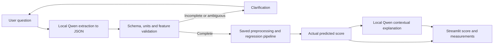
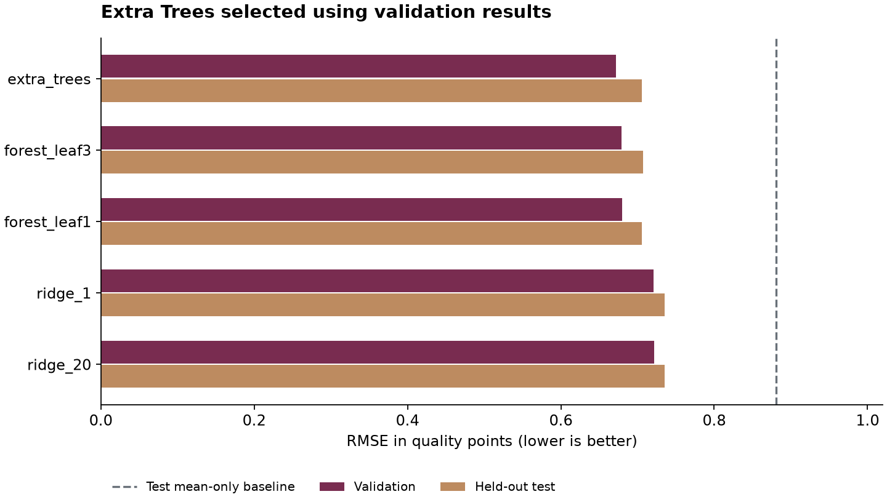

# Wine Quality Assistant

[](https://github.com/stevensherhouse/wine-quality-assistant/actions/workflows/tests.yml)

[Watch the two-minute demo](docs/demo/wine-quality-demo.mp4) · [Demo timeline](docs/demo/README.md)

A focused machine-learning application for students and wine analysts who have laboratory measurements and want an estimate of a wine's sensory quality. A Streamlit conversation uses a local Qwen2.5-7B language model to extract measurements, invokes a trained scikit-learn regression pipeline, and asks Qwen to explain the estimate. There are no API fees or API keys in the default local mode. Nebius remains an optional provider.

**Verified locally:** five completed MLflow experiments, real model inference, regression metrics, interface tests, and Streamlit interactions. Live local-LLM verification is documented in `reports/verification.md`. **Public submission repository:** [stevensherhouse/wine-quality-assistant](https://github.com/stevensherhouse/wine-quality-assistant). A completed two-minute demo is included below. The Dockerfile is included; a container build and cloud deployment have not been verified here. See `reports/verification.md` for the precise handoff status.

The updated suite has **26 passing tests**. The real local Qwen model also passed checks for a complete red-wine request, a white-wine request, missing values, ambiguous acidity, an out-of-scope query, and a follow-up completing earlier measurements. Actual outputs are saved in `reports/live_check.json`.

Local extraction uses a constrained JSON schema with all feature slots, allowing null for genuinely missing values. Explicit zeros remain valid measurements. This prevents omitted fields from silently becoming guessed inputs; nulls are removed before the missing-value clarification step. The live check compares every extracted measurement in the red-wine example with its expected value.

## Dataset and prediction task

- Source: [UCI Wine Quality](https://archive.ics.uci.edu/dataset/186/wine+quality), Cortez et al. (2009), [DOI](https://doi.org/10.24432/C56S3T), CC BY 4.0.
- Original data: 1,599 red and 4,898 white Portuguese Vinho Verde samples, totaling **6,497 rows**.
- Target: sensory `quality`, a numeric score on a **0–10** scale. Fractional predictions are estimates, not probabilities.
- Inputs: 11 physicochemical measurements plus `wine_type` (red/white). No brand, region, price, or tasting notes are used as predictors.
- Exact source-file SHA-256 hashes are saved in `data/manifest.json` and logged to MLflow. The loader recomputes hashes rather than trusting an old manifest.

Samples with identical features and wine type are grouped before splitting; repeated quality labels within a group are averaged. This leaves **5,320 unique feature groups**. It prevents identical measurements appearing in both training and evaluation data. It also changes the task slightly: each unique laboratory profile gets equal weight, and conflicting repeated sensory ratings become a mean score. This decision is documented rather than treating duplicate copies as independent evidence.

## Setup

Use **Python 3.12**. Run these commands from this repository's root.

```sh
python -m venv .venv
```

Activate on Windows PowerShell:

```powershell
.\.venv\Scripts\Activate.ps1
```

Or on macOS/Linux:

```sh
source .venv/bin/activate
```

Then install and train:

```sh
python -m pip install -r requirements.txt
python -m src.train --download
pytest tests/ -v
```

Training downloads the original UCI ZIP, prepares all splits, logs five distinct model configurations, and writes the selected pipeline to `models/best_model.joblib`. Running without `--download` reuses local CSVs. All training hyperparameters and split settings are read from `configs/config.yaml`.

## Set up the local LLM (no API key)

The default provider is **Qwen2.5-7B-Instruct**, running locally through **llama.cpp**. The public quantized model comes from [bartowski/Qwen2.5-7B-Instruct-GGUF on Hugging Face](https://huggingface.co/bartowski/Qwen2.5-7B-Instruct-GGUF), derived from [Qwen's Apache-2.0 upstream model](https://huggingface.co/Qwen/Qwen2.5-7B-Instruct). This satisfies the assignment's alternative-model option while keeping the regression model trained separately for this project.

On Windows x64 with a Vulkan-capable GPU:

```sh
python -m src.setup_local
python -m src.start_local
```

The one-time download is approximately 4.7 GB for the Q4_K_M model plus 32 MB for the portable runtime. Internet is needed for download; inference then runs locally. The setup script pins the runtime release, verifies its SHA-256 checksum, resolves a specific Hugging Face model revision, verifies the model checksum, and records provenance in `reports/local-model.json`. Binaries and weights live in ignored `local_runtime/` and `local_llm/` folders and are never committed to Git.

The verified machine has about 64 GB RAM and an RTX 4080 with 16 GB VRAM. Smaller machines may need a smaller model or CPU configuration; the included portable setup targets Windows/Vulkan. On another OS, install llama.cpp for that OS and serve the same GGUF model on loopback port 8080 with alias `wine-local` and at least 4,096 context tokens.

`start_local` starts the model service hidden in the background, bound to `127.0.0.1:8080`; logs and its process ID are in `local_runtime/`. The app communicates through its OpenAI-compatible API. A non-secret SDK placeholder is necessary for the OpenAI client, but the local server does not require or validate an API key. No real credentials are hardcoded.

The defaults work without `.env`. For explicit configuration, copy `.env.example` to `.env` (PowerShell: `Copy-Item .env.example .env`; macOS/Linux: `cp .env.example .env`) and use:

```dotenv
LLM_PROVIDER=local
LLM_BASE_URL=http://127.0.0.1:8080/v1
LLM_MODEL=wine-local
```

Do not stop or switch the model service during a conversation. Stop the model service through Task Manager by identifying the `llama-server.exe` process started for this project. Re-run `python -m src.start_local` to restart it later. Keeping the service running consumes GPU memory.

### Optional Nebius provider

To use Nebius instead, configure these privately in `.env`:

```dotenv
LLM_PROVIDER=nebius
NEBIUS_API_KEY=your_private_key
NEBIUS_MODEL=an_available_chat_model_from_your_console
NEBIUS_BASE_URL=https://api.tokenfactory.nebius.com/v1
```

Use an available chat model supporting JSON-object responses. Verify the current model ID and endpoint in your Nebius console. Nebius can charge for API usage; local mode avoids those charges. Keys are read from environment variables or the ignored `.env` file, never stored in source or chat. Restart Streamlit after changing provider settings.

## Run and interact

```sh
streamlit run src/app.py
```

Open `http://localhost:8501`. Example:

> Please rate this red wine: fixed acidity 7.4 g/L, volatile acidity 0.70 g/L, citric acid 0 g/L, residual sugar 1.9 g/L, chlorides 0.076 g/L, free sulfur dioxide 11 mg/L, total sulfur dioxide 34 mg/L, density 0.9978 g/cm3, pH 3.51, sulphates 0.56 g/L, alcohol 9.4%.

The checked trained regression model estimates approximately **5.00/10** for this illustrative row. It is a dataset-style example, not independent performance evidence. The held-out test set provides the performance evidence.

Try an incomplete query:

> I have a red wine with 11% alcohol. Rate it.

The app lists missing measurements and does not run a prediction. Add the remaining measurements in a follow-up message; valid previous values are retained. Explicitly correcting a measurement replaces its previous value. Click **Start a new wine** before switching samples, so earlier measurements are cleared.

Out-of-scope requests get a scope explanation. Unclear acidity, conflicting quantities, unknown fields, nonnumeric values, impossible sulfur relationships, and values outside training ranges trigger clarification. Marginal range checks reduce extrapolation but cannot identify every unusual multivariate sample. The LLM is fallible; review the expanded measurements before trusting a score.

## Architecture



`src/preprocess.py` copies and cleans data, imputes numeric medians and categorical modes, standardizes numeric features, and one-hot encodes wine type. All learned preprocessing is fitted **only on the training split**, in the same pipeline saved for inference. Scaling helps Ridge and is harmless for trees. The original UCI data is complete, but missing-value handling is tested for future datasets. The chat interface requires all measurements; training-time imputation is not a license for the LLM to invent user inputs.

`src/train.py` uses stratified-by-wine-type **60% train / 20% validation / 20% test** splits with seed 42: 3,192 / 1,064 / 1,064 rows. Five configurations cover Ridge, Random Forest, and Extra Trees. The chosen model has the lowest **validation RMSE**. Each model's test results are reported to meet the rubric, but they are never used to rank candidates. The saved winner remains fitted on the training split; there is no unreported refit on validation/test data.

`src/interface.py` separates extraction, schema checks, range checks, actual model inference, and explanation. In default mode, all language-model processing stays on this computer. The interface sends measurements to the loopback Qwen server for extraction, then sends only prediction metadata for explanation. Optional Nebius mode uses its external API instead. The UI displays the canonical score and test MAE independently of generated prose. Explanations are instructed to avoid unsupported causal contributions and invented tasting notes. If explanation generation fails after successful inference, a clearly labeled factual template preserves the actual result. If extraction fails, no prediction runs.

## Results

Sorted by validation RMSE; smaller MAE/RMSE is better, larger R² is better. Full-precision metrics, including MSE, are in `reports/experiments.csv`.

| Configuration | Validation RMSE | Test MAE | Test RMSE | Test R² |
|---|---:|---:|---:|---:|
| Extra Trees, 250 trees, depth 24 | **0.6719** | **0.5344** | **0.7058** | **0.3578** |
| Random Forest, leaf 3, depth 16 | 0.6794 | 0.5368 | 0.7069 | 0.3558 |
| Random Forest, leaf 1, depth 20 | 0.6798 | 0.5348 | 0.7059 | 0.3576 |
| Ridge, alpha 1 | 0.7212 | 0.5644 | 0.7350 | 0.3036 |
| Ridge, alpha 20 | 0.7214 | 0.5643 | 0.7349 | 0.3037 |
| Mean-only baseline | — | 0.6951 | 0.8808 | -0.0001 |

Extra Trees wins under the predefined validation rule. Its test RMSE improves about **19.9%** over the mean-only baseline. Its edge over the forests is small; these results do not establish statistical superiority. The nonlinear models outperform the two linear configurations on this split. A test MAE of 0.5344 means about half a quality point of average absolute error, **not an individual confidence interval**. R² around 0.36 leaves substantial variation unexplained, which is consistent with the limits of chemistry-only prediction of subjective scores. Do not interpret this model as a universal wine rating system.



## Experiments and reproducibility

```sh
python -m src.evaluate
mlflow ui --backend-store-uri sqlite:///mlflow.db --port 5000
```

Open `http://localhost:5000` and choose the `wine-quality` experiment. Each run logs explicit/default estimator parameters, preprocessing parameters, split settings, feature-group counts, dataset hashes/source, validation and test MAE/MSE/RMSE/R², configuration, input example, signature, and the trained model artifact. `src.evaluate.compare_runs()` uses **`mlflow.search_runs()`** and ranks finished runs from the same training batch by validation RMSE. It prints the best run ID. Failed setup attempts may appear alongside the five completed runs.

The local SQLite database, MLflow artifacts, raw CSVs, and model binaries are excluded from Git. They exist locally after training and are recreated by the documented command on a fresh clone. Commit source/configuration and the small results reports. The source hashes identify the precise data version. Tree parallelism and different platforms may introduce minor numerical differences.

## Testing and demo

```sh
pytest tests/ -v
python -m src.demo
```

The suite covers missing values, categorical encoding, scaling, dataframe immutability, training-only imputation, real model prediction shape/type, a held-out R² threshold of 0.25, improvement over the baseline, the provider parsing adapter, malformed responses, incomplete/ambiguous/out-of-scope requests, invalid values, follow-up inputs, explanation outages, and Streamlit interactions.

The ordinary tests use controlled provider responses and the **real trained model**. They verify application logic without spending API credits; they do not prove live LLM extraction accuracy. The offline demo is prominently labeled recorded extraction. It is never used by the production app.

With the local model service running, explicitly run the live checks and CLI demo:

```sh
python -m src.check_live
python -m src.demo --live
```

These commands call the real configured language model. Default local mode has no API fees; optional Nebius mode may incur API charges. `check_live` verifies complete extraction, actual prediction and explanation, incomplete input, ambiguous acidity, and scope rejection. It writes a success report only after assertions pass. The three-minute presentation/recording script is in [docs/DEMO.md](docs/DEMO.md). **Completed demo:** [two-minute captioned video](docs/demo/wine-quality-demo.mp4), with [timeline and presentation details](docs/demo/README.md). The video uses actual app captures, with processing waits shortened.

The GitHub Actions workflow trains and tests on a fresh Ubuntu/Python 3.12 runner. The [first complete remote verification passed](https://github.com/stevensherhouse/wine-quality-assistant/actions/runs/39703128389): dependency installation, five-model training, pytest, the offline smoke demo, and report upload all succeeded. The public check record is saved in `reports/ci-verification.json`. Documentation-only changes do not retrain models; code/configuration changes do.

## Docker and deployment

```sh
docker compose up --build
```

Download the GGUF first with `python -m src.setup_local`. The optional Compose recipe runs a CPU-only local LLM beside the app in a shared network namespace; it has no API key requirement, but may be slow. The app image trains during build and runs Streamlit as a non-root user. A health check targets Streamlit's health endpoint. The native Windows setup uses your GPU and is the primary local path. See [docs/DEPLOYMENT.md](docs/DEPLOYMENT.md) for optional Nebius containers, cloud handoff, remote tracking, and remaining operational work. Containers and cloud hosting have not been verified here.

## Repository map

```text
configs/config.yaml          Training/split configuration
src/data.py                  Download, hash, clean and group source data
src/preprocess.py            Shared preprocessing and feature contract
src/train.py                 Five models and MLflow tracking
src/evaluate.py              Metrics and programmatic run comparison
src/interface.py             Local/Nebius adapter, validation and model orchestration
src/setup_local.py           Verified runtime and Hugging Face model downloads
src/start_local.py           Starts the local Qwen service on loopback
src/app.py                   Streamlit conversational UI
src/demo.py                  Explicit offline or live CLI walkthrough
src/check_live.py            Opt-in live integration checks
tests/                       Preprocessing, model, interface and UI checks
reports/                     Results, experiment table and verification evidence
docs/                        Demo and deployment instructions
data/                        Ignored downloads; .gitkeep committed
models/                      Ignored trained model/test sample; .gitkeep committed
.github/workflows/tests.yml  Fresh-clone training and test workflow
```

## Reflection and improvements

The engineering work highlights why data boundaries matter as much as model choice: repeated laboratory profiles can inflate a random split's results, and preprocessing fitted before splitting can leak evaluation information. Keeping preprocessing and prediction together makes the deployed transformations match training. Comparing a baseline with several model families is more informative than reporting one model in isolation.

The central interface challenge is translating flexible language into a strict feature contract. Missing or ambiguous values need clarification; a plausible-sounding LLM answer is not evidence of a valid model input. Separating the numeric score from generated prose, checking ranges, and testing provider outages makes those boundaries visible.

With more time, add repeated group-aware cross-validation, uncertainty calibration, per-wine-type diagnostics, a larger live extraction benchmark with adversarial/unit-conversion cases, better detection of unusual feature combinations, drift monitoring, and a versioned model-release process. The current strict all-feature requirement trades convenience for avoiding silently assumed measurements. A guided form could improve usability while preserving that boundary.

The real local LLM check caught two extraction omissions: wine type and an explicitly stated zero. Requiring all feature slots in a constrained JSON schema, using null only for missing values, and adding a zero-preservation regression test corrected those cases. The completed demo also shows missing-input clarification and a follow-up that retains the previous alcohol value. Containers and cloud hosting remain unverified; this project demonstrates local execution.

## Submission

Public repository: **https://github.com/stevensherhouse/wine-quality-assistant**. Submit that URL. The repository includes the completed demo, training source, tests, configuration, results, and setup instructions. Raw datasets, trained binaries, downloaded LLM weights, local tracking storage, and credentials are excluded; setup recreates them.
