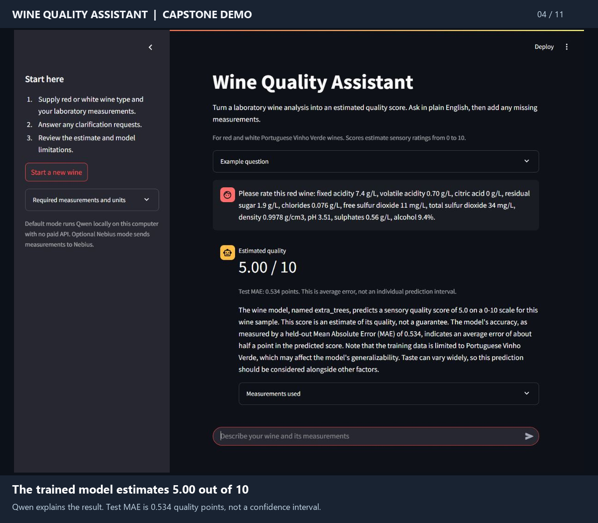

# Completed demo

[Watch or download the two-minute video](wine-quality-demo.mp4)

This silent, captioned walkthrough was assembled from screenshots captured while interacting with the actual Streamlit app on October 21, 2026. The local Qwen2.5-7B model performed extraction and explanation, and the saved Extra Trees pipeline generated the scores. Screens are held for readability, and processing waits are shortened. This is a presentation walkthrough rather than an uncut real-time screen recording.

| Time | Demonstration |
|---|---|
| 0:00 | Application purpose and local AI interface |
| 0:08 | Complete natural-language question with laboratory measurements |
| 0:18 | Actual processing screen |
| 0:22 | Model prediction of 5.00/10 and generated explanation |
| 0:40 | All 12 structured measurements, including citric acid of zero |
| 0:56 | Incomplete red-wine query with 11% alcohol |
| 1:04 | Clarification listing missing inputs; no invented prediction |
| 1:18 | User supplies remaining measurements in a follow-up |
| 1:28 | New prediction of 5.46/10, retaining 11% alcohol from the prior query |
| 1:42 | Out-of-scope Bitcoin question handled without a prediction |
| 1:50 | Five-configuration comparison and held-out results |

The two prediction examples are illustrative app demonstrations. The held-out test metrics reported in the README establish performance separately. The ordinary test suite uses controlled provider responses; the live-model checks and these app interactions used the real local model.
